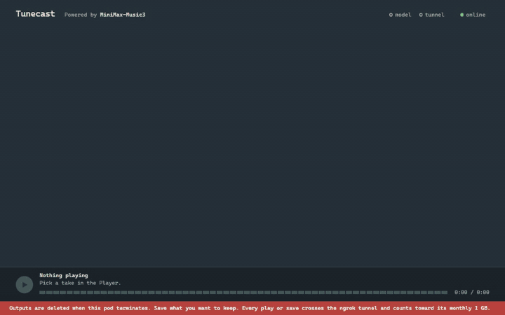
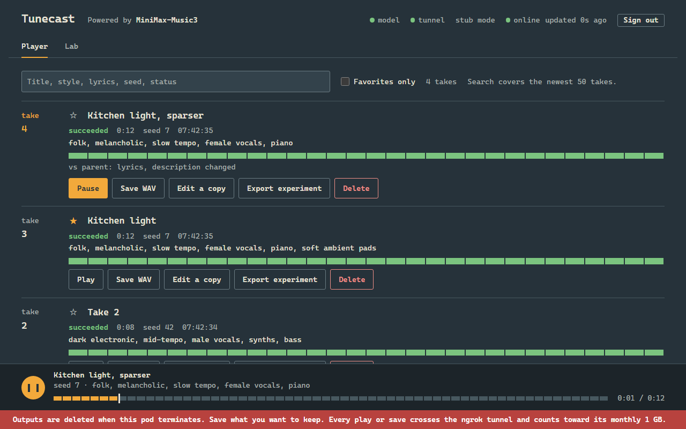
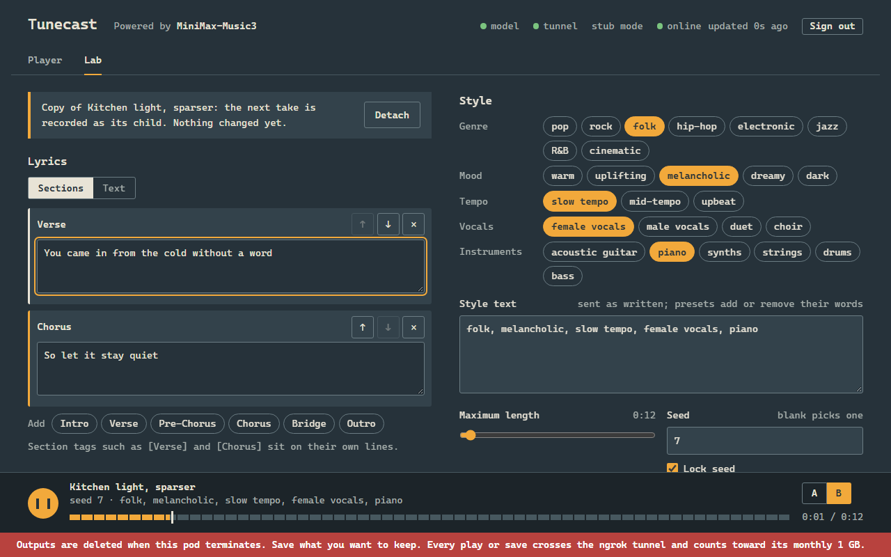
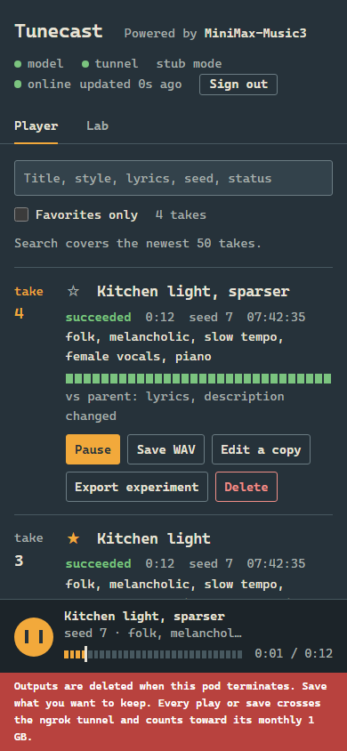
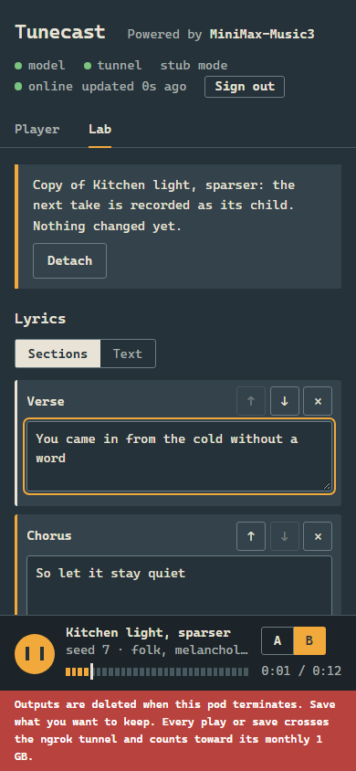
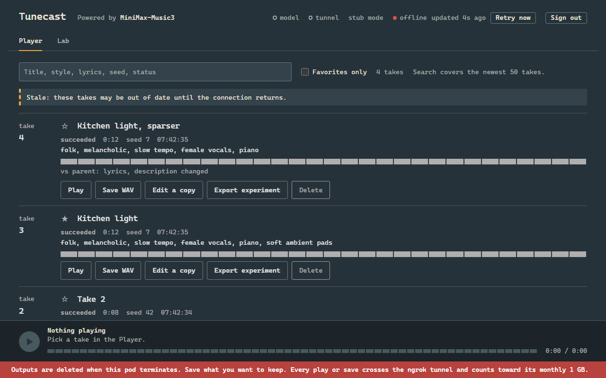

# Tunecast

Tunecast runs [MiniMax Music 3](https://huggingface.co/MiniMaxAI/MiniMax-Music3) on a rented RunPod GPU pod and puts a web app and a REST API in front of it. One Docker image holds the API (FastAPI, a SQLite job queue, bearer-key auth), the official SGLang-Omni inference server and an ngrok agent, so the UI sits on a fixed public URL while the pod is up. It is built for "start a pod, make a few songs, terminate it": nothing bills once the pod is terminated. In the one measured run a fresh pod was ready in 147.9 s and a 149 s song cost about US$0.085 (details [below](#one-measured-run-2026-09-03)).

Powered by **MiniMax-Music3**. Licence: MiniMax-Music3 Community License. Commercial
use is allowed; the UI must display "MiniMax-Music3" (it does); above US$20M/yr
revenue you need written authorisation from MiniMax; a hosted service must block the
licence's Exhibit A prohibited uses. Read the licence before serving other people.

## See it, hear it, click through it

The pod is off, so none of this needs a GPU.



The Player and the Lab are two tabs over one queue and one `<audio>` element. Switching tabs does not interrupt playback or drop a draft; the recording above plays a take, opens the Lab with a copy of it, and returns to the Player.

<p>


</p>
<p>



</p>

**These screenshots and the recording come from the stub sidecar, not the model.** `scripts/capture_media.py` boots the real app with the stub inference backend: each take is a 400 Hz sine tone a few seconds long, the titles and lyrics are made up for the shot, and the per-take timing line is hidden because stub timings are not measurements. They show the interface and say nothing about the music. The tunnel lamp is forced on in the stub render, so it does not show the real tunnel state. The last image is the page after the server was stopped: offline indicator, retry button, stale-takes notice.

### The one real sample

[`song-client.wav`](song-client.wav) (19.1 MB) is the one real output kept from the measured pod run, and the only generated audio in this repo. It is 149.188 s of 32 kHz 16-bit stereo audio: a Hindi romantic ballad from 697 characters of lyrics with a structured style caption, seed 7, a 180 s maximum, generated through the client script and the ngrok tunnel on 2026-09-03. The model stopped at 149 s because the lyrics ran out; the run took 153.9 s of inference. Download it or open the raw file; the offline demo below plays it in the page.

### Offline demo

`demo/` is the real UI running with no server. A small script (`demo/shim.js`) answers the page's API calls from `demo/fixtures.json`. `scripts/build_demo.py` copies `app.js` and `app.css` byte for byte from `tunecast/static/` and writes `index.html` from the real page with four edits: the title, the asset paths made relative, the shim script added, and a permanent banner that reads "OFFLINE DEMO — recorded fixtures, no GPU, nothing is generated". `demo/demo.css` is hand-written and hides the pod-only chrome.

```bash
python -m http.server 8000     # from the repo root
# open http://localhost:8000/demo/
```

- The only take is the measured run above, with its real lyrics, style, seed and the numbers from the measured-run table: 2:29 of audio, 2:33 of inference, 1.03x real time. It plays `song-client.wav`.
- Nothing is generated. **Start take** is disabled with a reason, and the model and tunnel lamps are red because there is no model. Edit a copy, title, favorite and delete work in the page's memory only; a reload restores the fixture.
- It needs a static server, not `file://`. GitHub Pages serving `main` from the repo root would serve it at `/demo/`; Pages is not enabled, so there is no hosted link.
- The generated files in `demo/` (`index.html`, `app.js`, `app.css`) are committed so no build step is needed. `uv run pytest` fails if they fall behind `tunecast/static/`; refresh them with `python scripts/build_demo.py`.

## Where to read more

| | |
| --- | --- |
| [`ARCHITECTURE.md`](ARCHITECTURE.md) | components, data flow of one generation, invariants |
| [`DECISIONS.md`](DECISIONS.md) | why each choice was made, with the alternatives rejected |
| [`EXPLANATION.md`](EXPLANATION.md) | what each task built and how it was verified |
| [`RUNBOOK.md`](RUNBOOK.md) | RunPod template, per-session commands, job recovery, troubleshooting, teardown |

## Setup in short

1. **Docker Hub**: an access token, added to this GitHub repo as secrets `DOCKERHUB_USERNAME` and `DOCKERHUB_TOKEN`. Every push to `main` then builds and pushes `arpitkadam/tunecast:latest` and an immutable `sha-<7>` tag.
2. **ngrok**: the agent authtoken and a static dev domain. The REST API key is a different thing and will not start a tunnel.
3. **API key**: a long random string, the only credential for the API and UI.
4. **RunPod template**: image `arpitkadam/tunecast:latest`, 2 x L40S, 20 GB container disk, **80 GB volume disk mounted at `/workspace`**, HTTP port 8080, and the environment variables `TUNECAST_API_KEY`, `NGROK_AUTHTOKEN`, `NGROK_DOMAIN`. Full table in [`RUNBOOK.md`](RUNBOOK.md#runpod-template); `.env.example` documents every variable.
5. **Each session**: deploy a pod, wait for `api_ready` in the pod logs (148 s on the fresh pod I measured), open the ngrok URL, enter the key, make songs, save the WAVs, terminate the pod. Outputs live only for the pod's lifetime. Steps in [`RUNBOOK.md`](RUNBOOK.md#per-session-spin-up).

If something goes wrong: [troubleshooting](RUNBOOK.md#troubleshooting), [recovering a job after the client dies](RUNBOOK.md#5-recover-a-job-when-the-client-dies), [teardown](RUNBOOK.md#teardown), [boot exit codes](RUNBOOK.md#boot-exit-codes).

## How it fits together

```
browser / client/generate.py
   │  HTTPS + Bearer key
   ▼
ngrok  sliding-ethically-beckham.ngrok-free.dev
   │
   ▼  RunPod pod, 2×L40S
tunecast.boot (PID 1 under tini)
   ├─ FastAPI :8080   auth, job queue, WAV storage, UI, /ready
   │     └─ HTTP ──▶ sgl-omni serve :8000 (official inference server)
   │                  GPU 0: Qwen3-8B autoregressive stage
   │                  GPU 1: flow-matching + waveform decode
   ├─ ngrok agent (restarted with backoff if it drops)
   └─ /workspace (pod volume disk): weights 57.4 GB, outputs, jobs.db, logs
```

- Weights (`MiniMaxAI/MiniMax-Music3`, revision `fbdf52fb…`, 57.4 GB) download on the
  first boot of every fresh pod and are verified by a size manifest. They are never
  inside the image.
- Outputs live only for the pod's lifetime. Save what you want to keep before you
  terminate.
- The image is `arpitkadam/tunecast` on Docker Hub, built by GitHub Actions from
  this repo, pinned to a base image digest and exact package versions.


## API

All routes except `/health`, `/ready` and `/` need `Authorization: Bearer <key>`.
Add `ngrok-skip-browser-warning: 1` to skip ngrok's interstitial on non-browser
clients.

| Method | Path | What |
| --- | --- | --- |
| POST | `/jobs` | body `{"lyrics","description","duration_s":180,"seed":null,"format":"wav"}` → 202 with the job. Optional `parent_job_id` (must exist, else 422) and `experiment_id`; a child inherits its parent's experiment, a root starts its own; 429 when the queue is full, 503 when the model server is not ready (both carry `Retry-After`, nothing is created) |
| GET | `/jobs?limit=50` | newest first |
| GET | `/jobs/{id}` | status, `queue_position` (jobs ahead), `progress` (estimate), `estimate` (`seconds`, `confidence` low\|medium; null once finished), `timings` (`queue_wait_s`, `inference_s`), `real_time_factor`, `gpu` (peak memory per GPU during inference), lineage, `model_revision`, `config_snapshot`, `error` |
| GET | `/jobs/{id}/audio` | the WAV (409 until succeeded) |
| GET | `/experiments/{id}/export?format=json\|csv` | every job in the experiment with lineage and measurements, as a download. 404 unknown experiment, 422 bad format |
| DELETE | `/jobs/{id}` | 204; cancels a queued job, deletes a finished one; 409 while running (a running job cannot be cancelled) |
| GET | `/info` | model, revision, sidecar, GPUs, limits |

Limits: lyrics ≤ 20 000 chars, description ≤ 10 000, `duration_s` 1–360,
seed 0–2³¹−1. **`duration_s` is a maximum, not a target.** It sets
`max_new_tokens` to `duration_s × 25` frames; the model ends the song when it
decides the lyrics are finished, which is usually sooner. A 180 s request with
short lyrics produced 149 s of audio in the measured run. Write more lyrics to
get a longer song; raising `duration_s` alone only raises the ceiling. Output is 32 kHz 16-bit stereo WAV
(≈ 7.7 MB per minute). These are the parameters the official inference server
accepts; sampling temperature, top-p/top-k and reference audio are rejected by it.

## Client script

```bash
python client/generate.py --url https://sliding-ethically-beckham.ngrok-free.dev \
  --key "$TUNECAST_API_KEY" --lyrics-file client/example-lyrics-en.txt \
  --description "$(cat client/example-style-en.txt)" \
  --duration 180 --seed 7 --out song.wav
```

`client/example-lyrics-en.txt` and `client/example-style-en.txt` are a worked
example: an English hushed romantic ballad, with the style written as the
structured caption MiniMax Music 3 expects (Global Metadata, Vocal Details,
Arrangement). Lyrics carry `[Verse]`, `[Chorus]`, `[Bridge]` and `[Outro]` tags on
their own lines. The measured run used a Hindi ballad instead; its exact lyrics
and style text are in `demo/fixtures.json`.

Prints queue position and progress, saves the file, exits 0. Exit 1 means the
server reported a failed job (its message is printed), exit 2 means auth failure
or a connection that stayed broken. Transport errors and 5xx responses are
retried five times, three seconds apart, because a free ngrok tunnel drops a
connection occasionally and the job keeps running on the server regardless. If
it does give up, it prints the job URL so you can collect the audio later
instead of paying to generate it again. Standard library only, runs on any
Python 3.

## Local development (no GPU)

```bash
uv sync --group dev
uv run pytest -q
TUNECAST_STUB=1 NGROK_ENABLED=0 TUNECAST_API_KEY=dev uv run python -m tunecast.boot
```

Stub mode swaps the inference server for a generator that writes a 400 Hz sine
of the requested length, so the API, queue, UI and client run without CUDA. With
`NGROK_ENABLED=1` and your ngrok variables in `.env` the real tunnel comes up too.
On Windows use `TUNECAST_PORT=8090` if something else owns 8080.

## One measured run (2026-09-03)

This is one run, not a benchmark suite. Hardware: a 2 × L40S pod (driver
580.178.04), image `sha-304cb59`, on 2026-09-03. Request: 697 characters of
Hindi lyrics with a structured style caption, seed 7, maximum length 180 s,
sent through the client script and the ngrok tunnel. The pod was fresh, so the
cold start includes the full weights download. It was not repeated: there are
no averages, no variance and no comparison with other hardware or settings.

| Metric | Value |
| --- | --- |
| Fresh pod: boot → `api_ready`, including the 54 GB download | 147.9 s |
| Weights download + verify | 57.2 s (≈ 950 MB/s) |
| Model load (`sidecar_start` → `sidecar_ready`) | 90.2 s |
| Inference | 153.9 s of compute for 149.2 s of audio (ratio 1.03) |
| GPU 0 under load | 26,685 MiB, 96–97 % utilisation |
| GPU 1 under load | 13,957 MiB, bursting to 100 % |
| Cost per song at US$1.98/h | ≈ US$0.085 |
| Cold start cost | ≈ US$0.08 |

A session of four songs would be roughly 13 minutes of pod time, about US$0.42
(projected from this run's cold start and inference time, not measured).
Both GPUs are genuinely used: the autoregressive stage sits on GPU 0 and the
flow-matching and waveform decode on GPU 1.

**Separate CI observations, not part of the run above:** image builds on GitHub Actions took 14–19 min and produced a 14.84 GB compressed image.

## Song length is set by your lyrics

`duration_s` is a ceiling, never a target. The model ends the song when the
lyrics run out. From the one measured run, roughly **0.21 seconds of audio per
character of lyrics**. The rate and the table below are extrapolated linearly
from that run; no song at these lengths was measured:

| Target | Approximate lyrics |
| --- | --- |
| 2 minutes | ~560 characters |
| 3 minutes | ~850 characters |
| 5 minutes | ~1,400 characters |

Measured point: 697 characters of Hindi lyrics produced 149 seconds of audio.
Leaving `duration_s` at 180, or even 360, is harmless; it only has to be high
enough not to truncate the song.

`client/example-lyrics-en.txt` (English, hushed romantic ballad) is sized for
roughly three minutes, with its structured caption in
`client/example-style-en.txt`. The Hindi pair behind the 697-character
measurement is reproduced in `demo/fixtures.json`.

## Limitations

- ngrok free plan: 1 GB transfer per month. A 3-minute WAV is ~23 MB, so roughly
  40 downloads a month. The UI fetches a take's audio, with the key, only when you press
  Play, Save WAV or flip A/B; choosing takes in the A/B selects fetches nothing. Each
  loaded take stays in browser memory as a blob until it leaves the list or the page reloads.
- The interstitial page cannot be removed on the free plan.
- Progress while a job runs is an estimate; the inference server does not stream,
  and the estimator needs a few full-length jobs before it is accurate. Its first
  prediction after a short test job will be far too high.
- Song length cannot be set directly. It follows from lyric quantity; see above.
- Outputs are not persisted beyond the pod. Prune keeps the last 200 succeeded
  jobs within a session.
- Weight integrity is checked by file sizes plus a marker, not by hashing.
- One shared key, no per-user accounts, no rate limiting.

## Serverless note

RunPod serverless would cut idle cost to zero between requests, but every cold
worker would either re-download 57 GB or need a network volume (the monthly cost
this design avoids). For a few songs a month, a pod you terminate is cheaper.
